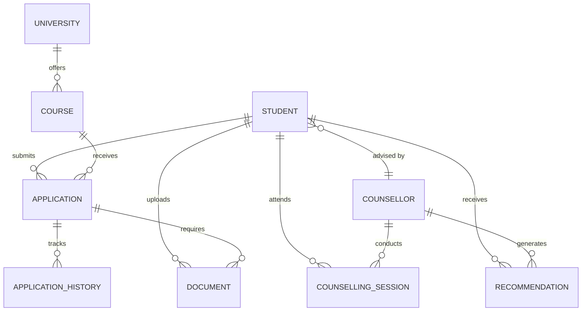

# Abroad Education Counselling and Student Application Management System

[](#)
[](https://www.python.org/)
[](https://www.djangoproject.com/)
[](https://www.django-rest-framework.org/)
[](https://couchdb.apache.org/)

---

## 📌 Project Overview

The **Abroad Education Counselling and Student Application Management System** is a centralized web platform designed for overseas education counselling agencies. It streamlines and replaces traditional fragmented spreadsheets, physical paperwork, and disconnected records with a document-oriented NoSQL database.

The system supports the entire **counselling-to-application workflow**, allowing students to manage their profiles and track applications, counsellors to mentor students and verify documents, and administrators to oversee master data, staff workload, and system operations.

### 👥 Project Contributors
- **Christin Jose Biju** (26MAI0055)
- **Ridhin Jayan** (26MAI0059)
- **Lakshay S** (26MAI0064)

---

## 🏗️ Architecture & Technology Stack

| Layer | Technology / Component | Key Responsibilities |
| :--- | :--- | :--- |
| **Presentation Layer** | React 18, React Router, Vite, CSS3 | Responsive single-page web interface, forms, and role-specific dashboards |
| **API & Backend Layer**| Python, Django, Django REST Framework (DRF) | Business logic, authentication/authorization (RBAC), validation, RESTful endpoints |
| **Database Layer** | Apache CouchDB (Document-Oriented NoSQL) | JSON document storage, revisions, views, and attachments |
| **Version Control** | Git & GitHub | Source code management and team collaboration |

---

## 👥 User Roles & Access Control

The system implements strict **Role-Based Access Control (RBAC)** across three primary user classes:

```
                  ┌──────────────────────┐
                  │    Authentication    │
                  │   & Role Management  │
                  └──────────┬───────────┘
                             │
         ┌───────────────────┼───────────────────┐
         ▼                   ▼                   ▼
  ┌─────────────┐     ┌──────────────┐    ┌───────────────┐
  │   Student   │     │  Counsellor  │    │ Administrator │
  └──────┬──────┘     └──────┬───────┘    └───────┬───────┘
         │                   │                    │
         ├─ Personal Profile ├─ Assigned Students ├─ User Management
         ├─ Search Unis      ├─ Counselling Logs  ├─ Uni & Course Master
         ├─ Applications     ├─ Review & Verify   ├─ Workload Overview
         └─ Track Documents  └─ Recommendations   └─ System Analytics
```

1. **Student**:
   - Maintain personal, academic, and preference profiles.
   - Search universities and programs.
   - Submit and track applications and upload required documents (SOP, LOR, transcripts).
   - View counsellor recommendations, notes, and notifications.

2. **Counsellor**:
   - Manage assigned students and track individual student pipelines.
   - Schedule sessions, record discussion notes, and set follow-up tasks.
   - Review and verify student documents.
   - Provide rule-based course/university recommendations.

3. **Administrator**:
   - Manage user accounts, role delegations, and counsellor student assignments.
   - Manage master data: Universities, courses, countries, and intake deadlines.
   - Access global analytics, reports, and system audit logs.

---

## 🌟 Core System Modules & Features

- **🔐 Authentication & Role Management**: Secure token/session-based authentication with strict role authorization at API level.
- **🎓 Student Management**: Profiles, academic background (GPA, degree, graduation year), preferred intake/countries, and budget range.
- **🤝 Counsellor Management**: Counsellor profiles, student allocations, workload overview, and session scheduling.
- **🏫 University & Course Management**: Database of universities, courses, eligibility criteria, tuition fees, and intake seasons.
- **📝 Application Management**: Application lifecycle tracking across statuses:
  `Planned` ➔ `Shortlisted` ➔ `Documents Pending` ➔ `Submitted` ➔ `Under Review` ➔ `Offer Received` / `Rejected` / `Withdrawn` / `Completed`
- **📁 Document Management**: Manage metadata and file uploads for Transcripts, Degree Certificates, Passports, SOPs, LORs, and Test Scores with status flags (`Required`, `Uploaded`, `Under Review`, `Verified`, `Rejected`, `Expired`).
- **💡 Recommendation & Matching Engine**: Deterministic rule-based scoring of the catalogue on country, course area, academic fit, intake and budget, with hard eligibility rules (level, entry grade, English, open intake), persisted reasons and missing-data reporting; counsellors accept, reject, re-tier or add courses.
- **📊 Dashboards & Reporting**: Role-specific dashboards with recommendations, review queues, follow-ups, filters by counsellor/country/intake and reports by country, university and intake.
- **🔔 Notifications & Reminders**: In-app notifications for status changes, requested/rejected documents, deadlines and follow-ups, with a bell, an inbox and idempotent scheduled reminders.

---

## 🗄️ Apache CouchDB Data Model

Data is stored as JSON documents within Apache CouchDB using the `doc_type` attribute for logical categorization.



### Document Types Summary

| Document Type | Purpose | Key Attributes |
| :--- | :--- | :--- |
| `user` | Account & authentication | `user_id`, `username`, `email`, `role`, `password_hash`, `is_active` |
| `student` | Student master profile | `student_id`, `user_id`, `personal`, `academic`, `preferences`, `counsellor_id` |
| `counsellor` | Counsellor profile | `counsellor_id`, `user_id`, `name`, `specialization`, `assigned_student_ids` |
| `university` | University records | `university_id`, `name`, `country_id`, `location`, `website`, `ranking` |
| `course` | Programs offered | `course_id`, `university_id`, `name`, `level`, `duration`, `tuition`, `eligibility` |
| `application` | University application | `application_id`, `student_id`, `university_id`, `course_id`, `intake_id`, `status`, `deadline` |
| `document` | Document metadata | `document_id`, `student_id`, `application_id`, `document_type`, `filename`, `status` |
| `counselling_session`| Session records | `session_id`, `student_id`, `counsellor_id`, `date_time`, `summary`, `follow_up` |
| `recommendation` | University suggestion | `recommendation_id`, `student_id`, `university_id`, `course_id`, `match_factors` |
| `application_history`| Status audit trail | `history_id`, `application_id`, `old_status`, `new_status`, `changed_by`, `timestamp` |

---

### Example JSON Document Structures

#### 1. Student Document (`doc_type: "student"`)
```json
{
  "_id": "student_001",
  "doc_type": "student",
  "user_id": "user_001",
  "personal": {
    "name": "Alex Mercer",
    "email": "alex.mercer@example.com",
    "phone": "+1234567890"
  },
  "academic": {
    "degree": "B.E. Computer Science",
    "cgpa": 8.5,
    "graduation_year": 2026
  },
  "preferences": {
    "countries": ["Germany", "Canada"],
    "course_area": ["Computer Science", "AI/ML"],
    "intake": "Fall 2027",
    "budget": {
      "amount": 25000,
      "currency": "EUR"
    }
  },
  "counsellor_id": "counsellor_001",
  "created_at": "2026-03-01T10:00:00Z",
  "updated_at": "2026-03-05T14:30:00Z"
}
```

#### 2. Application Document (`doc_type: "application"`)
```json
{
  "_id": "application_001",
  "doc_type": "application",
  "student_id": "student_001",
  "university_id": "university_014",
  "course_id": "course_014_02",
  "intake_id": "intake_fall_2027",
  "status": "Documents Pending",
  "deadline": "2027-01-15",
  "history_ids": ["history_001", "history_002"],
  "created_at": "2026-03-10T09:00:00Z",
  "updated_at": "2026-03-12T11:20:00Z"
}
```

---

## ⚡ Non-Functional & Quality Requirements

- **Performance**: API responses within ~2 seconds; dashboard loads within ~3 seconds under local development conditions. Pagination supported across collections.
- **Reliability & Recovery**: Graceful degradation during CouchDB connectivity interruptions and structured error logging without exposing secrets.
- **Security**: Passwords hashed securely, API-level RBAC validation, input sanitization, and environment-based secret configuration.

---

## 📂 Project Structure

```
AEC_Management_System/
├── backend/                     Django REST API (Python)
│   ├── manage.py
│   ├── requirements.txt
│   ├── config/                  Project configuration: settings, root URL map, WSGI/ASGI
│   ├── apps/                    One package per business domain
│   │   ├── core/                Shared infrastructure: CouchDB client & repository, audit log,
│   │   │                        error handling, roles, health check, management commands
│   │   ├── accounts/            User documents, login/registration, tokens, role permissions
│   │   ├── students/            Student profile documents, CRUD, counsellor assignment
│   │   ├── counsellors/         Counsellor profiles, CRUD, workload
│   │   ├── universities/        University & course search
│   │   ├── dashboard/           Role-specific dashboard summaries
│   │   ├── applications/        Applications, status workflow & history, intakes and deadlines
│   │   ├── documents/           Document checklist, uploads (CouchDB attachments), verification
│   │   ├── counselling/         Counselling sessions, notes, follow-ups, calendar
│   │   ├── recommendations/     Rule-based recommendation engine, refresh and counsellor review
│   │   └── notifications/       In-app notifications, business-event hooks, scheduled reminders
│   └── tests/                   API tests (run against an in-memory CouchDB stand-in)
├── frontend/                    React web client (Vite), built into frontend/dist and served by Django
│   ├── package.json             npm scripts: dev, build
│   ├── vite.config.js           Build to dist/ under /static/; dev server proxies /api to Django
│   └── src/
│       ├── App.jsx              Routes and role-based route guard
│       ├── lib/                 API client & session, form helpers, data-loading hooks
│       ├── components/          App shell (sidebar/top bar), drawers, toasts, badges, document widgets
│       ├── pages/               One component per screen
│       └── styles/app.css       Design tokens & components
├── docs/                        Sprint notes and project documentation
├── .env.example                 Configuration template (copy to .env, never commit .env)
└── output/                      Local dataset exports (git-ignored, never committed)
```

Each domain app follows the same layout: `services.py` (document structure and business rules),
`serializers.py` (input validation), `views.py` (API endpoints) and `urls.py`.

---

## 🚀 Getting Started

### Quick Start (One Command)
After initial setup, simply run from the repository root in **PowerShell as Administrator**:
```powershell
.\run.ps1
```

### Prerequisites
- **Python 3.10+**
- **Node.js 18+** (with npm) to build the React frontend
- **Apache CouchDB 3.x+** running locally or accessible over network (default: `http://127.0.0.1:5984/`)
- **Git**
- **PowerShell** (for using `run.ps1` script)

### Installation Steps

1. **Clone the Repository**
   ```bash
   git clone https://github.com/freebooter1052/AEC_Management_System.git
   cd AEC_Management_System
   ```

2. **Configure Environment Variables**: copy `.env.example` to `.env` in the repository root and fill in
   your CouchDB credentials and a `DJANGO_SECRET_KEY`.

   **Forgot password:** users reset their own password from the sign-in page with a 6-digit code sent by
   email (valid 10 minutes). With `EMAIL_HOST` left empty the code is printed in the `runserver` console,
   which is enough for development. To send real email set `EMAIL_HOST`, `EMAIL_HOST_USER` and
   `EMAIL_HOST_PASSWORD` in `.env` (for Gmail, `smtp.gmail.com` and an App Password); see `.env.example`.

3. **Set Up the Backend** (all commands run from `backend/`)
   ```bash
   cd backend
   python -m venv myenv
   # Windows (PowerShell): .\myenv\Scripts\Activate.ps1      Linux/macOS: source myenv/bin/activate
   pip install -r requirements.txt
   ```

4. **Initialise CouchDB and Data** (there are no SQL migrations; CouchDB is the only database)
   ```bash
   python manage.py init_couchdb                         # database, Mango indexes and map/reduce views (safe to re-run)
   python manage.py load_universities                    # loads ../output/universities.json
   python manage.py create_admin --email you@example.com # first administrator (prompts for password)
   python manage.py check_indexes                        # verify indexes/views (builds the views; re-run if it times out)
   ```
   CouchDB builds the views on first use. On a large database run `check_indexes` once after
   `init_couchdb` so the first page load does not wait for the build.

5. **Start the Application**

   Use the provided `run.ps1` script to start everything in one command (recommended):
   ```powershell
   # Run from the repository root in PowerShell (as Administrator)
   .\run.ps1
   ```

   This script will:
   - Start the Apache CouchDB service
   - Initialize the database and Mango indexes
   - Install the frontend packages (first run only) and build the React app
   - Start the Django development server

   Access the application in your browser at `http://127.0.0.1:8000/`.

   **Alternative (manual steps):**
   ```bash
   cd frontend && npm install && npm run build      # build the React app into frontend/dist
   cd ../backend && python manage.py runserver      # serves the UI and the API on :8000
   ```

6. **Working on the Frontend** (live reload)
   ```bash
   # keep `python manage.py runserver` running on :8000, then in frontend/:
   npm run dev                                      # http://127.0.0.1:5173 - changes appear instantly
   ```
   Re-run `npm run build` (or `.\run.ps1`) to update what is served on :8000. Built files have
   content-hashed names, so browsers always load the latest version with no cache clearing.

7. **Run the Tests** (no CouchDB needed)
   ```bash
   cd backend && python manage.py test tests        # 136 API, engine and data-layer tests (in-memory CouchDB)
   cd frontend && npm test                          # 28 unit tests for the frontend helpers
   ```

8. **Reminders** (deadlines, outstanding documents, follow-ups)

   In-app reminders are created by an idempotent command; run it as often as you like. Schedule it daily, e.g. on Windows:
   ```powershell
   schtasks /Create /TN "AEC reminders" /SC DAILY /ST 07:00 /TR "<repo>\backend\myenv\Scripts\python.exe <repo>\backend\manage.py send_reminders"
   ```
   Without a schedule, students and counsellors still get their own reminders when they open the dashboard or
   notifications (at most every 15 minutes per user). `send_reminders --date YYYY-MM-DD` simulates another day.

9. **Benchmarks** (optional; never touches `counselling_db`)
   ```powershell
   $env:COUCHDB_NAME = "aec_bench_1000"
   python manage.py init_couchdb
   python manage.py bench_seed --students 1000 --copy-catalogue-from counselling_db   # refuses any DB not named aec_bench*
   python manage.py check_indexes                                                    # builds and verifies the views
   python manage.py runserver 127.0.0.1:8001                                         # in a second terminal, same env
   python manage.py bench_run --base-url http://127.0.0.1:8001 --requests 100 --concurrency 1 8
   ```
   Results print as a table and are saved under `output/benchmarks/` (git-ignored). Method and results:
   [`docs/SPRINT3_TEST_REPORT.md`](docs/SPRINT3_TEST_REPORT.md).

### Troubleshooting
| Symptom | Cause and fix |
|---|---|
| Pages show "The database is temporarily unavailable" | CouchDB is not running: `Start-Service "Apache CouchDB"` (Administrator) |
| The first dashboard after an update is slow or returns 503 | CouchDB is building the map/reduce views: run `python manage.py check_indexes` and wait for it to finish |
| `check_indexes` reports a full scan | The indexes are missing: run `python manage.py init_couchdb` |
| No reminders appear | Run `python manage.py send_reminders`, or schedule it (step 8) |
| Recommendations say "Eligibility to confirm" and budget "Not assessed" | The imported catalogue has no entry requirements or tuition: an administrator can record them per course (Universities → a university → Edit) |

---

## 📖 Project Documentation
- [`docs/SPRINT1_FOUNDATION.md`](docs/SPRINT1_FOUNDATION.md), [`docs/SPRINT2_WORKFLOW.md`](docs/SPRINT2_WORKFLOW.md), [`docs/SPRINT3_IMPLEMENTATION_REPORT.md`](docs/SPRINT3_IMPLEMENTATION_REPORT.md): what each sprint delivered and why
- [`docs/SPRINT3_TEST_REPORT.md`](docs/SPRINT3_TEST_REPORT.md): test results and benchmarks
- [`docs/API_DOCUMENTATION.md`](docs/API_DOCUMENTATION.md): every endpoint
- [`docs/DATA_MODEL.md`](docs/DATA_MODEL.md), [`docs/DATABASE_AND_SCALABILITY.md`](docs/DATABASE_AND_SCALABILITY.md): documents, indexes, views, consistency

## 📖 References
- IEEE Recommended Practice for Software Requirements Specifications (IEEE 830-1998)
- [Django Documentation](https://docs.djangoproject.com/)
- [Django REST Framework Documentation](https://www.django-rest-framework.org/)
- [Apache CouchDB Documentation](https://docs.couchdb.org/)
